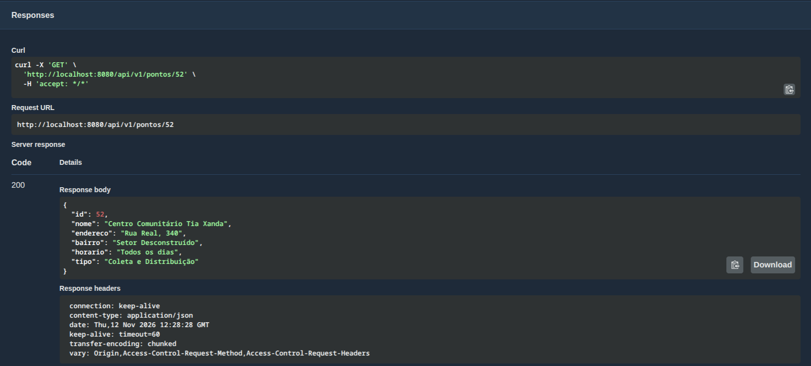
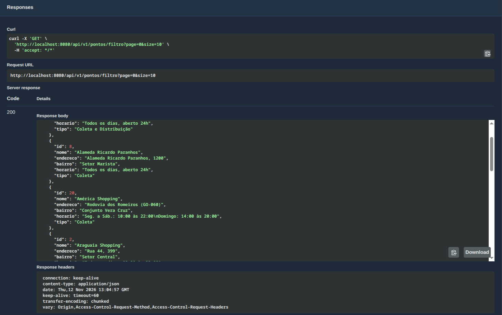
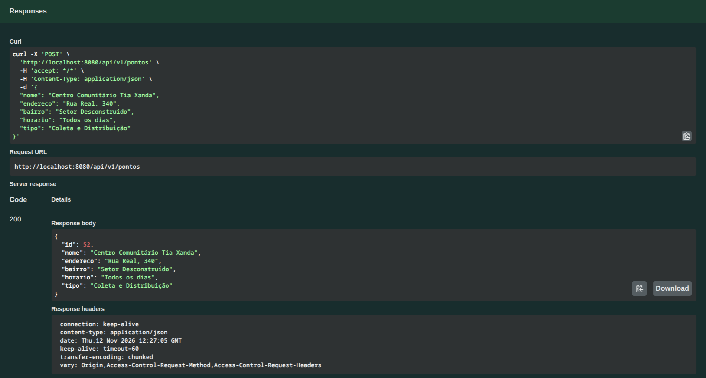
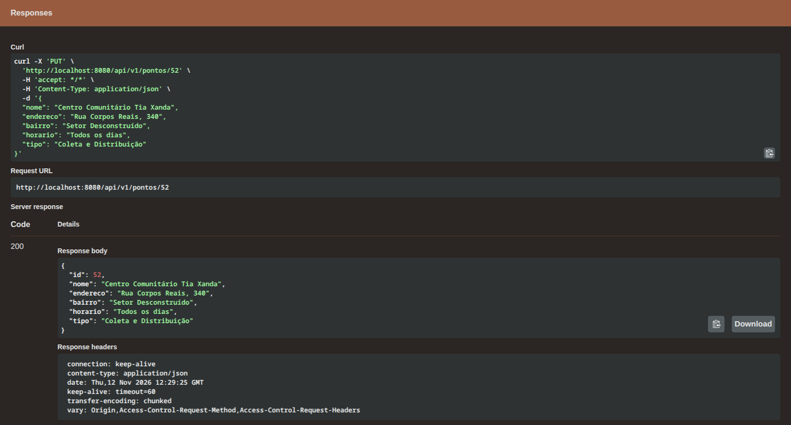
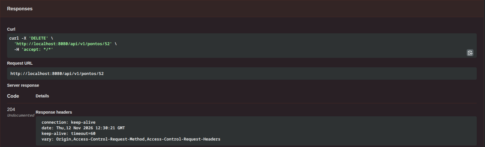
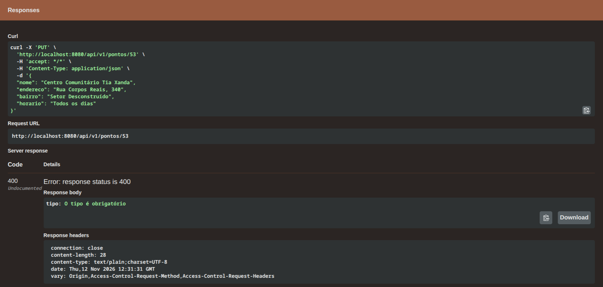
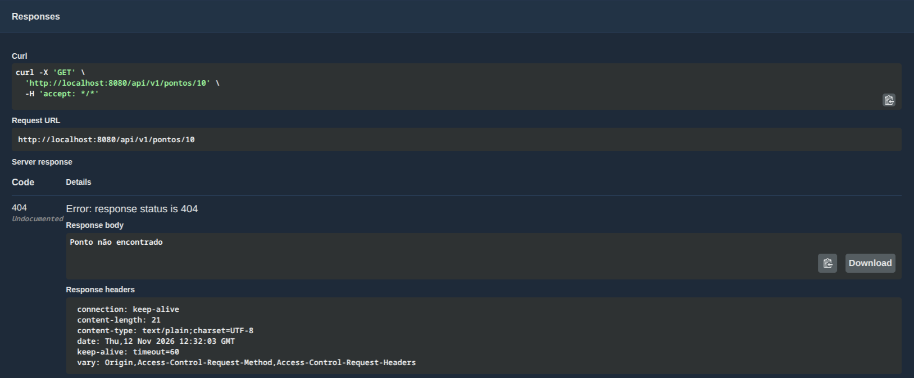
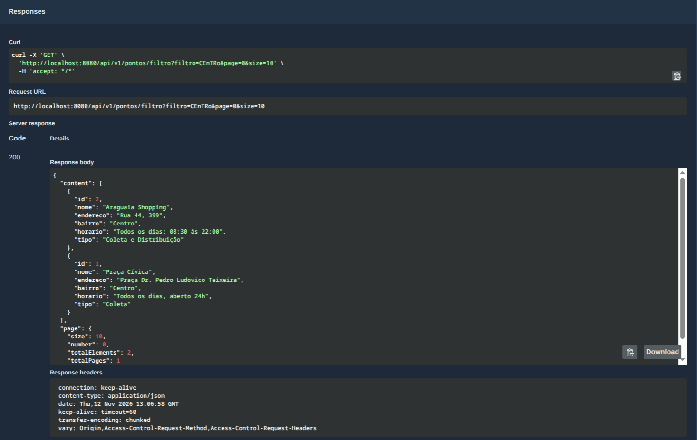
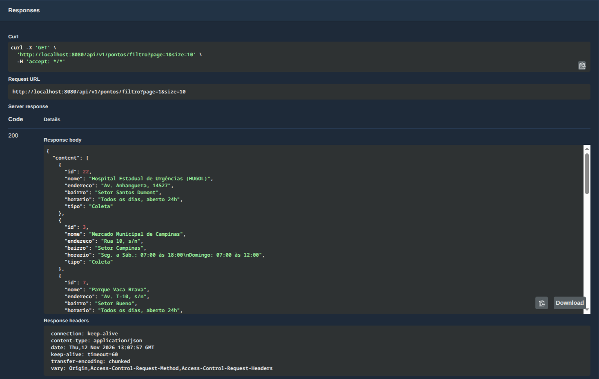

# ☕ Instituto Mão Amiga - Backend API

API REST desenvolvida em **Java 25** com **Spring Boot 4.1.1** para o gerenciamento de **Pontos de Coleta/Distribuição** e controle de **Doações**.

---

## 🛠️ Tecnologias e Recursos

- **Java 25**
- **Spring Boot 4.1.1**
  - Spring Web MVC
  - Spring Data JPA
  - Bean Validation (`jakarta.validation`)
- **H2 Database** (persistência em arquivo com auto-server)
- **SpringDoc OpenAPI (Swagger UI)** para testes e documentação interativa
- **Lombok**
- **CORS** habilitado globalmente para integração com frontends

---

## 🚀 Como Executar

### 1. Pré-requisitos
- **JDK 25+** instalado e configurado no PATH (ou via SDKMAN com `.sdkmanrc`)

### 2. Executando a API
A partir da pasta raiz do projeto ou dentro de `backend/`:

```bash
cd backend
./mvnw spring-boot:run
```
*(No Windows, utilize `.\mvnw.cmd spring-boot:run`)*

A API estará disponível em: **`http://localhost:8080`**

### 3. Links Úteis
- **Swagger UI (Documentação e Testes):** [http://localhost:8080/swagger-ui.html](http://localhost:8080/swagger-ui.html)
- **H2 Console:** [http://localhost:8080/h2-console](http://localhost:8080/h2-console)
  - **JDBC URL:** `jdbc:h2:file:./backend/data/mao-amiga-db;AUTO_SERVER=TRUE;`
  - **User Name:** `sa`
  - **Password:** *(em branco)*

---

## 📍 Endpoints da API

### 1. Gerenciamento de Pontos (`/api/v1/pontos`)

| Método | URL Completa | Descrição | Status Sucesso | Status Erros |
| :---: | :--- | :--- | :---: | :---: |
| `GET` | `http://localhost:8080/api/v1/pontos/filtro` | Busca paginada de pontos com filtro por nome ou bairro (`?filtro=...&page=0&size=10&sort=nome,asc`) | `200 OK` | - |
| `GET` | `http://localhost:8080/api/v1/pontos/{id}` | Busca os detalhes de um ponto específico por ID | `200 OK` | `404 Not Found` |
| `GET` | `http://localhost:8080/api/v1/pontos/resumo` | Lista resumida (`id` e `nome`) para seletores | `200 OK` | - |
| `POST` | `http://localhost:8080/api/v1/pontos` | Cadastra um novo ponto de coleta/distribuição | `200 OK` | `400 Bad Request` |
| `PUT` | `http://localhost:8080/api/v1/pontos/{id}` | Atualiza os dados de um ponto existente | `200 OK` | `400 Bad Request`<br>`404 Not Found` |
| `DELETE` | `http://localhost:8080/api/v1/pontos/{id}` | Remove um ponto pelo ID | `204 No Content` | `404 Not Found` |

#### Payload de Envio (`PontoRequestDTO`):
> Todos os campos são **obrigatórios e não vazios** (`@NotBlank`). Enviar qualquer campo vazio responderá `400 Bad Request` e nada será gravado.
```json
{
  "nome": "Sesc Faiçalville",
  "endereco": "Av. Ipanema, Qd. 234/236, 1600",
  "bairro": "Setor Faiçalville",
  "horario": "Seg a Sex, 8h às 17h",
  "tipo": "coleta"
}
```

#### Payload de Resposta (`PontoResponseDTO`):
```json
{
  "id": 1,
  "nome": "Sesc Faiçalville",
  "endereco": "Av. Ipanema, Qd. 234/236, 1600",
  "bairro": "Setor Faiçalville",
  "horario": "Seg a Sex, 8h às 17h",
  "tipo": "coleta"
}
```

---

### 2. Gerenciamento de Doações (`/api/v1/doacoes`)

| Método | URL Completa | Descrição | Status Sucesso | Status Erros |
| :---: | :--- | :--- | :---: | :---: |
| `GET` | `http://localhost:8080/api/v1/doacoes` | Lista todas as doações cadastradas | `200 OK` | - |
| `GET` | `http://localhost:8080/api/v1/doacoes/{id}` | Busca os detalhes de uma doação por ID | `200 OK` | `404 Not Found` |
| `GET` | `http://localhost:8080/api/v1/doacoes/tipo/{tipoItem}` | Filtra doações por tipo de item | `200 OK` | - |
| `POST` | `http://localhost:8080/api/v1/doacoes` | Registra uma nova doação | `200 OK` | `400 Bad Request` |
| `PUT` | `http://localhost:8080/api/v1/doacoes/{id}` | Atualiza uma doação existente | `200 OK` | `400 / 404` |
| `DELETE` | `http://localhost:8080/api/v1/doacoes/{id}` | Remove uma doação por ID | `204 No Content` | `404 Not Found` |

---

## 📸 Evidências de Testes no Swagger UI

Abaixo constam as capturas de tela demonstrando a execução de cada endpoint diretamente pelo **Swagger UI** (`http://localhost:8080/swagger-ui.html`), contemplando os fluxos de sucesso e os cenários de erro `400` e `404`.

> **Local das imagens:** As capturas estão salvas em `docs/swagger/`.

---

### 1. Busca de Ponto por ID (`GET /api/v1/pontos/{id}`) — Status 200 OK
Retorna os detalhes completos do ponto correspondente ao ID informado.



---

### 2. Busca Paginada sem Filtro (`GET /api/v1/pontos/filtro?page=0&size=10`) — Status 200 OK
Retorna a listagem paginada (10 itens por página) ordenada por nome, com a estrutura serializada em `content` e `page`.



---

### 3. Cadastro de Ponto (`POST /api/v1/pontos`) — Status 200 OK
Cria um novo ponto a partir dos dados validados no `PontoRequestDTO`.



---

### 4. Edição de Ponto (`PUT /api/v1/pontos/{id}`) — Status 200 OK
Atualiza os atributos do ponto existente pelo ID informado.



---

### 5. Exclusão de Ponto (`DELETE /api/v1/pontos/{id}`) — Status 204 No Content
Remove o ponto do banco de dados e retorna código 204 sem corpo.



---

### 6. Campo Obrigatório Vazio (`POST /api/v1/pontos`) — Status 400 Bad Request
Demonstração do Bean Validation (`@Valid` e `@NotBlank`): ao enviar qualquer campo obrigatório em branco (ex: `"nome": ""`), a API rejeita a requisição com **400 Bad Request** e nenhuma informação é persistida no banco.



---

### 7. ID Inexistente (`GET /api/v1/pontos/{id}`) — Status 404 Not Found
Demonstração do tratamento de exceção (`EntityNotFound` via `GlobalExceptionHandler`): ao consultar ou atualizar um ID que não existe no banco, a API responde prontamente com **404 Not Found**.



---

### 8. Busca com Filtro por Bairro ou Nome (`GET /api/v1/pontos/filtro?filtro=...&page=0&size=10`) — Status 200 OK
Filtra os pontos comparando case-insensitive com nome ou bairro via query customizada no repositório.



---

### 9. Busca Paginada - Segunda Página (`GET /api/v1/pontos/filtro?page=1&size=10`) — Status 200 OK
Navegação para a página subsequente (`page=1`), demonstrando a paginação e a quantidade total de registros da carga inicial (mais de 25 pontos).




